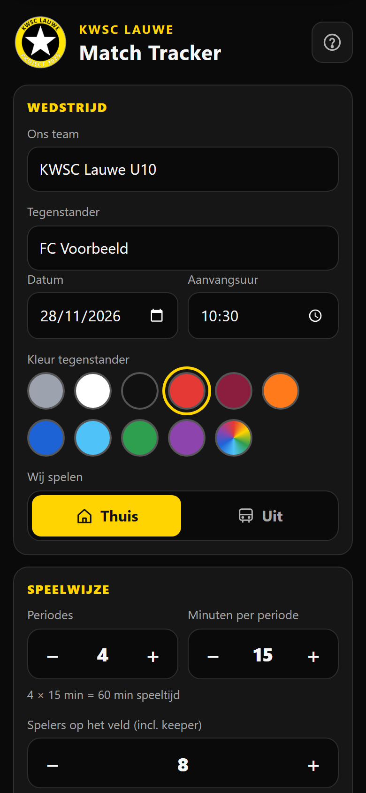
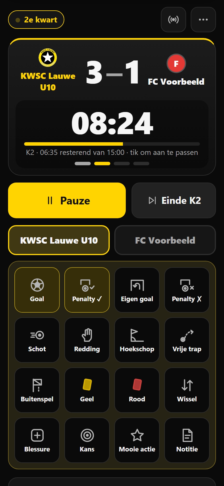
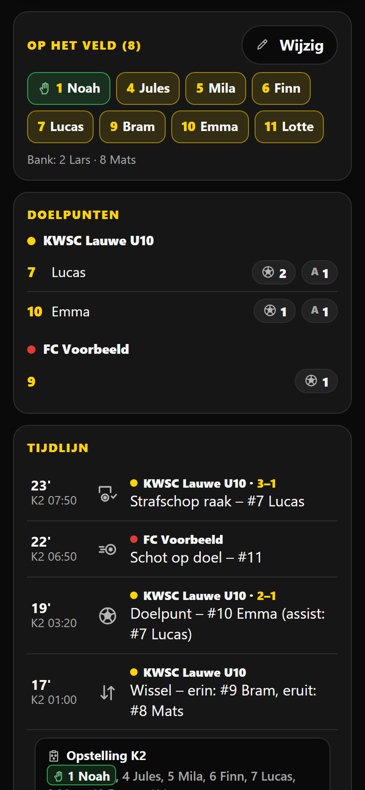
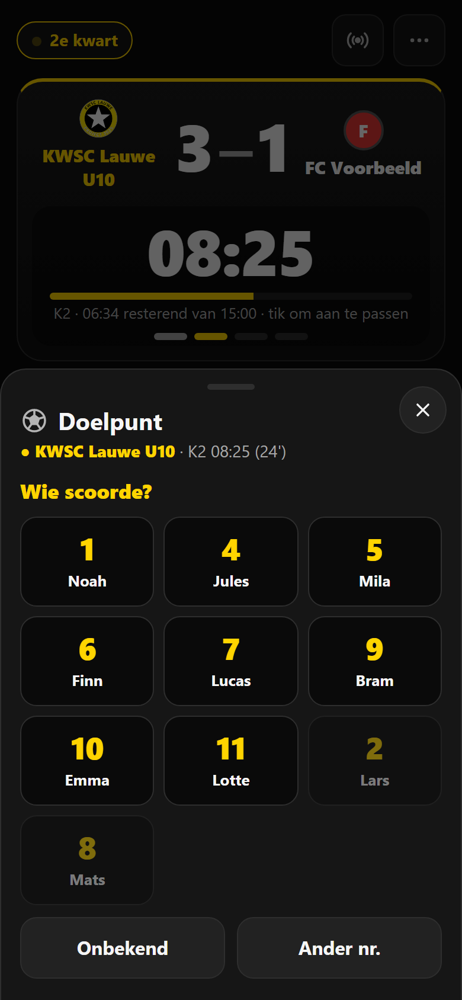
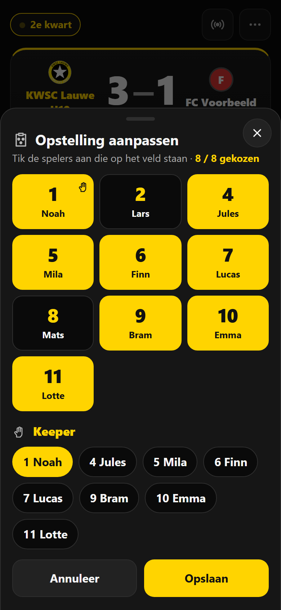
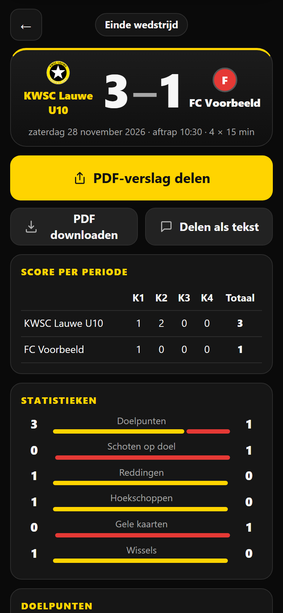
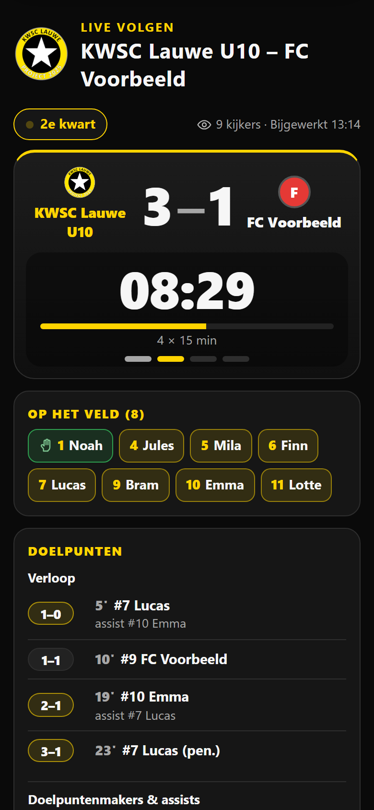
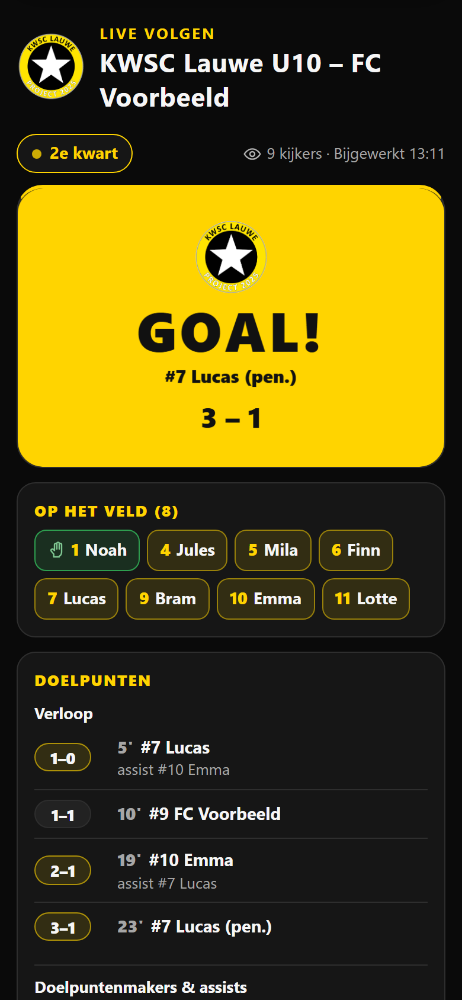
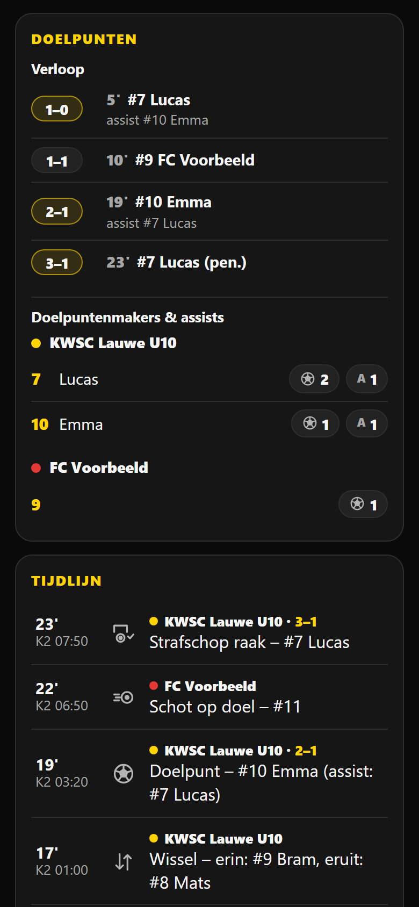

# KWSC Lauwe – Match Tracker

Een mobiele web-app om een jeugdvoetbalwedstrijd van KWSC Lauwe bij te houden vanaf de zijlijn: klok, score, acties per ploeg, opstelling en wissels, een PDF-verslag achteraf en een live link waarmee andere ouders kunnen meekijken.

**Live:** <https://matchtracker.bpitconsulting.be/>

Een korte gebruikershandleiding staat in de app zelf (het **?**-icoon) en op <https://matchtracker.bpitconsulting.be/handleiding.html>.

Op een telefoon openen en via *Deel → Zet op beginscherm* (iPhone) of *⋮ → Toevoegen aan startscherm* (Android) installeren. Daarna werkt de app als een gewone app, ook zonder internet op het veld.

---

## Screenshots

Met fictieve demodata (geen echte spelers). Bijwerken: zie [Screenshots vernieuwen](#screenshots-vernieuwen).

**Coach-app**

| Instellen | Tijdens de wedstrijd | Op het veld & doelpunten |
|:---:|:---:|:---:|
|  |  |  |
| **Wie scoorde?** | **Opstelling met keeper** | **Verslag** |
|  |  |  |

**Ouderview (live link)**

| Live volgen | Animatie bij een doelpunt | Verloop & doelpuntenmakers |
|:---:|:---:|:---:|
|  |  |  |

**Verder:** [doelpunten in het verslag](docs/screenshots/07-verslag-doelpunten.png) · [handleiding](docs/screenshots/11-handleiding.png)

---

## Inhoud van de repo

| Bestand | Wat het is |
|---|---|
| `index.html` | De volledige app: HTML, CSS en JavaScript in één bestand, zonder externe bibliotheken of build-stap. |
| `handleiding.html` | Korte handleiding voor gebruikers, te openen via het **?**-icoon op het instellingenscherm en via *Menu → Handleiding*. Ook offline beschikbaar. |
| `mockups/iconen.html` | Ontwerp-mockup van de actie-iconen (variant A/B voor de kaarten). Niet gebruikt door de app. |
| `mockups/symbolen.html` | Ontwerp-mockup van de overige symbolen (knoppen, menu, live delen). Niet gebruikt door de app. |
| `mockups/ouderview.html` | Ontwerp-mockup van het doelpuntenoverzicht in de ouderview (variant B is ingebouwd). Niet gebruikt door de app. |
| `mockups/goal-animaties.html` | Mockup met zes mogelijke animaties bij een doelpunt in de ouderview (variant 6, volledig scherm, is ingebouwd). |
| `mockups/verloop.html` | Mockup met drie voorstellen om het doelpuntenverloop in kolommen te tonen. |
| `mockups/verloop-v2.html` | Mockup van het gekozen verloop: stand als bolletje links, daarnaast tijd, scorer en assist (ingebouwd). |
| `docs/screenshots/` | Screenshots voor deze README (fictieve demodata). |
| `tools/screenshots.mjs` | Script dat de screenshots automatisch maakt met Chrome/Edge in de achtergrond. |
| `sw.js` | Service worker: bewaart de app offline en zorgt dat nieuwe versies meteen binnenkomen. |
| `manifest.webmanifest` | Web-app-manifest (naam, icoon, kleuren) zodat de app op het beginscherm geïnstalleerd kan worden. |
| `logo.png` | Clublogo van KWSC Lauwe (app-icoon, kop van de app en van het PDF-verslag). |
| `database.rules.json` | Beveiligingsregels van de Firebase Realtime Database voor het live delen. Ter referentie: de regels moeten met de hand in de Firebase-console geplakt worden. |
| `CNAME` | Eigen domein voor GitHub Pages: `matchtracker.bpitconsulting.be` (niet verwijderen). |
| `.gitignore` | Sluit lokale instellingen (`.claude/`) uit. |

---

## Functies

**Instellen**
- Datum en aanvangsuur (standaard vandaag en het volgende volle of halve uur, zolang je ze niet zelf aanpast).
- Ons team (standaard *KWSC Lauwe*), tegenstander, kleur tegenstander (10 vaste kleuren of een eigen kleur), thuis of uit.
- Speelwijze: aantal periodes, minuten per periode, aantal spelers op het veld (incl. keeper), klok toont gespeelde of resterende tijd.
- Spelers: raster van rugnummers waar je een naam aan koppelt; het aantal rugnummers in de selectie is instelbaar. Spelers worden onthouden voor volgende wedstrijden.
- Overzetten: *Exporteren* geeft een code (`KWSC1:…`) met spelers, ploegnaam en speelwijze; die plak je op een ander toestel of nieuw adres bij *Importeren*.

**Tijdens de wedstrijd**
- Klok per periode met pauze, aanpassen (±10 s, ±1 min, exact instellen) en een alarm (geluid + trillen) als de tijd om is. De klok blijft correct lopen als de telefoon vergrendeld wordt; het scherm blijft aan zolang de klok loopt.
- 16 acties voor beide ploegen: doelpunt (met optionele assist), strafschop raak/gemist, eigen doelpunt, schot, redding, hoekschop, vrije trap, buitenspel, gele/rode kaart, wissel, blessure, grote kans, mooie actie, notitie.
- Voor onze ploeg verschijnt een keuzevenster met rugnummers en namen; voor de tegenstander alleen een optioneel rugnummer.
- Elke actie kan ongedaan gemaakt, bewerkt (ploeg, tijd, spelers, notitie) of verwijderd worden.
- Zodra er gescoord is, toont de wedstrijdpagina een kaart met doelpuntenmakers en assistgevers.
- Elk keuzevenster sluit met de ✕ rechtsboven, door het naar beneden te vegen of door ernaast te tikken.

**Opstelling**
- Bij de aftrap en op het einde van elke periode kies je wie (start) op het veld staat, en duid je een keeper aan. Nooit meer spelers dan ingesteld.
- Wissels werken de opstelling automatisch bij (erin = bank, eruit = veld). Een redding wordt meteen aan de keeper gekoppeld; wie de keeper vervangt wordt keeper.
- Rood of twee keer geel haalt een speler van het veld; uitgesloten spelers kunnen niet meer terugkomen.
- In de tijdlijn staat elke opstelling met nummer en naam; de keeper is in de lijst gemarkeerd.

**Na de wedstrijd**
- Verslag met eindstand, score per periode, statistieken, doelpunten (eerst het verloop met tussenstand, dan de rangschikking van doelpuntenmakers en assistgevers) en alle acties. Tijdens de match te openen via *Menu → Verslag & PDF*.
- PDF-verslag (A4, met clublogo, aanvangsuur en een overzicht van doelpuntenmakers en assistgevers) delen of downloaden, of het verslag als tekst delen (bv. WhatsApp).

**Live link voor ouders**
- Met 📡 *Start live delen* krijg je een link (`…/index.html?volg=<code>`). Ouders zien zonder account het aanvangsuur (tot de aftrap), de score, de klok, wie op het veld staat (tot het einde van de match), het verloop van de doelpunten met daaronder de doelpuntenmakers en assistgevers, en de tijdlijn, live bijgewerkt.
- Het aantal (anonieme) kijkers is zichtbaar voor ouders en coach.
- Scoort onze ploeg, dan wordt het scorebord bij de ouders ±2,5 s geel met "GOAL!", scorer, assist en nieuwe stand (niet bij een tegendoelpunt en niet als de telefoon "minder beweging" gebruikt).
- Een nieuwe wedstrijd starten of *Stop live delen* sluit het delen netjes af ("Live gestopt").
- Live wedstrijden worden na 7 dagen automatisch uit de database gewist door de telefoon die ze aanmaakte.

---

## Hoe het werkt

### Opslag op de telefoon
Alles staat in `localStorage` van de browser; er is geen eigen server.

| Sleutel | Inhoud |
|---|---|
| `kwsc.match.v2` | De huidige wedstrijd: instellingen, status, klok en alle acties. |
| `kwsc.prefs.v2` | Voorkeuren die bewaard blijven tussen wedstrijden (team, speelwijze, spelers). |
| `kwsc.auth` | Anoniem Firebase-account van deze telefoon (tokens), alleen nodig voor live delen. |
| `kwsc.published` | Live wedstrijden die deze telefoon aanmaakte (voor het automatisch opruimen). |
| `kwsc.viewerId` | Willekeurige anonieme code als deze telefoon als ouder meekijkt. |

### Gegevensmodel
Een wedstrijd is een lijst **acties** (`events`). Score, statistieken, opstelling, keeper en uitsluitingen worden telkens **uit die lijst afgeleid** in plaats van apart bijgehouden. Daardoor blijft alles kloppen na ongedaan maken, bewerken of verwijderen.

- Gewone actie: `{type, team:'us'|'them', period, sec, player, assist, in, out, note}`
- Systeemactie (`sys:true`): `period_start`, `period_end` en `lineup` (opstelling met `players` en `keeper`).
- Spelers worden opgeslagen als label, bv. `"#7 Lucas"`.

### Live delen (Firebase)
- Firebase Realtime Database via de **REST-API**, zonder Firebase-SDK.
- De coach-telefoon meldt zich **anoniem** aan (Firebase Authentication) en schrijft de volledige wedstrijd naar `/matches/<code>` bij elke wijziging, plus elke 20 s tijdens het spel zodat de klok bij de ouders synchroon blijft.
- Ouders lezen mee via `EventSource` (server-sent events), met elke 15 s ophalen als vangnet.
- De klok bij de ouders volgt de gespeelde tijd die de coach doorstuurt, zodat een verschil tussen de klokken van beide telefoons geen rol speelt.
- Kijkers schrijven elke 30 s een servertijdstip naar `/viewers/<code>/<anonieme code>`; wie in de laatste 70 s een seintje gaf, telt mee.

Configuratie staat bovenaan het blok *LIVE DELEN* in `index.html` (`LIVE.apiKey`, `LIVE.dbUrl`). Deze waarden zijn bij Firebase publiek bedoeld; de beveiliging zit in de regels.

### Beveiligingsregels (`database.rules.json`)
- `/matches/<code>`: iedereen met de link mag lezen; alleen het account dat de wedstrijd aanmaakte mag ze wijzigen of verwijderen. De lijst van alle wedstrijden opvragen kan niet.
- `/viewers/<code>/<id>`: een kijker mag alleen een eigen tijdstip schrijven, en alleen bij een bestaande wedstrijd. De eigenaar van de wedstrijd mag de kijkers wissen.

Firebase-project: `kwsc-matchtracker`. In de Firebase-console moet **Authentication → Anoniem** aanstaan (zonder *auto clean-up*: een gewist account kan zijn lopende wedstrijd niet meer bijwerken).

### PDF
Het PDF-verslag wordt in de browser zelf gemaakt door een kleine ingebouwde PDF-generator (Helvetica, A4, logo als JPEG). Daardoor werkt het ook offline.

### Iconen
Alle iconen zijn inline SVG-symbolen bovenaan `<body>` in `index.html`: `i-…` voor de acties, `s-…` voor de overige symbolen. Gebruik in de code via `ico('goal')` en `sym('live')`.

`handleiding.html` bevat een **kopie** van dezelfde symbolen. Pas je een icoon aan in `index.html`, kopieer dan het `<svg … aria-hidden="true">`-blok ook naar de handleiding. De ontwerpen staan in `mockups/` (open ze lokaal in de browser).

---

## Structuur van `index.html`

Het script is opgedeeld in blokken met een kopcommentaar:

1. **Constanten**: acties (`TYPES`), vragen in de keuzevensters, kleuren.
2. **state**: laden/bewaren van de wedstrijd en voorkeuren; meekijkmodus bij `?volg=`.
3. **helpers**: namen, kleuren, tijdnotatie, score, beschrijving van acties.
4. **views / INSTELLEN / LIVE**: de schermen instellen en wedstrijd, klok en knoppen.
5. **opstelling**: wie op het veld staat, keeper, uitsluitingen, opstellingsvenster.
6. **sheets**: keuzevensters (spelers, notitie, bewerken, klok, menu).
7. **VERSLAG**: verslagscherm, statistieken, delen als tekst.
8. **PDF**: PDF-generator.
9. **LIVE DELEN**: Firebase-aanmelding, publiceren, opruimen, kijkers, meekijkpagina.
10. **start**: opstarten en updates van de service worker.

---

## Ontwikkelen en publiceren

**Lokaal draaien** (een webserver is nodig; `file://` werkt niet door `localStorage` en de service worker):

```powershell
python -m http.server 5173
```

en open <http://localhost:5173>.

**Publiceren:** de site draait op GitHub Pages vanaf de `main`-branch (root), op het eigen domein `matchtracker.bpitconsulting.be` (CNAME-record bij de domeinbeheerder naar `bertpinoy.github.io`, HTTPS verplicht). Het oude adres `bertpinoy.github.io/MatchTracker` stuurt automatisch door. Elke push naar `main` staat binnen ongeveer een minuut online.

**Bij een nieuwe functie:** werk ook `handleiding.html` bij als het gebruik verandert.

**Bij elke wijziging aan de app:** verhoog het versienummer van `CACHE` in `sw.js` (bv. `kwsc-match-v35` → `v36`). Dan installeert de nieuwe versie zich op de telefoons en herlaadt de app zichzelf de volgende keer dat hij geopend wordt.

**Firebase-regels wijzigen:** pas `database.rules.json` aan en plak de inhoud in de Firebase-console (*Realtime Database → Regels → Publiceren*). De repo publiceert de regels niet automatisch.

### Screenshots vernieuwen
Na een zichtbare wijziging kan je de screenshots in `docs/screenshots/` opnieuw laten maken. Start de lokale webserver en draai daarna het script (Node 22+ en Chrome of Edge nodig):

```powershell
node tools/screenshots.mjs
```

Het script opent de app onzichtbaar op telefoonformaat, vult fictieve demodata in en bewaart elf screenshots. Er gaat niets naar Firebase.
---

## Privacy

- De wedstrijd en de spelerslijst staan alleen op de telefoon van de coach.
- Bij live delen gaan alleen de wedstrijdgegevens naar Firebase, inclusief de voornamen die bij acties of in de opstelling gekozen zijn; niet de volledige spelerslijst. Wie de link heeft, kan meekijken.
- Kijkers zijn anoniem: alleen een willekeurige code met een tijdstip.
- Live wedstrijden en kijkersgegevens worden na 7 dagen gewist.
